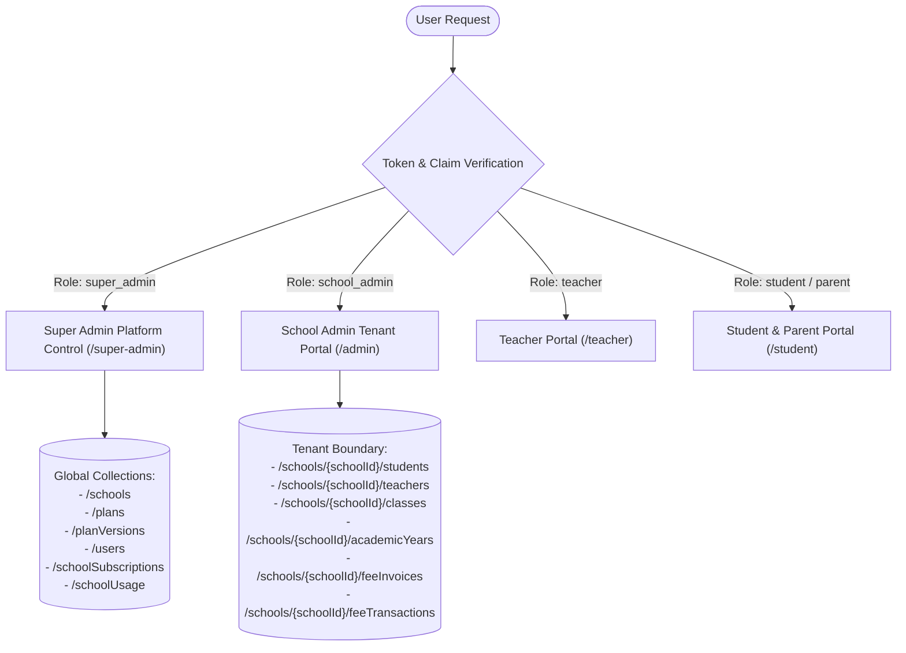

# School Study SaaS — Architecture System Map

## 1. Executive Summary & Core Stack

School Study (`Vinkal93/School-study`) is a multi-tenant cloud-native School Management & ERP SaaS platform deployed at `https://school.sbci.online`.

| Layer | Technology | Version | Purpose |
|---|---|---|---|
| **Framework** | Next.js (App Router, Turbopack) | `16.4.3` | Hybrid Static & Server-rendered SSR/API Architecture |
| **Runtime & UI** | React / React DOM | `19.2.8` | Client State, Contexts, Hooks, Server Components |
| **Styling** | Tailwind CSS / Lucide / MagicUI | `3.4.17` / `1.34` | Responsive Design System & Glassmorphism Dashboards |
| **Client Database** | Firebase Client SDK | `12.18.0` | Client Auth, Real-time Snapshot Listeners |
| **Server Database** | Firebase Admin SDK | `14.3.0` | Server-Side Firestore Mutations, Custom Claims, Batch Transactions |
| **Payment Gateway** | Razorpay Node SDK | `2.9.8` | Subscriptions, Mandates, Webhooks, Fee Checkout |
| **Hosting & Edge** | Vercel Serverless Functions | Node.js 20/24 | API Routing, SSR Pages, Static Optimization |

---

## 2. Multi-Tenant Architecture & Data Boundaries

The architecture operates on an isolated tenant boundary enforced at both the Firestore Security Rules level and the Server API Authorization level:

### Tenant Identification:
- Every school has a canonical document ID `schoolId` (e.g. `nNuxKZJ0vL13fZDhA...`).
- Authenticated users have `schoolId` embedded in Firebase Auth Custom Claims (`request.auth.token.schoolId`) and their profile document `users/{uid}`.
- Tenant data resides in subcollections (`schools/{schoolId}/*`) or partitioned root documents with strict `schoolId` queries.

---

## 3. Role-Based Access Control (RBAC) Matrix

| Role | Access Scope | Key Permissions | Boundaries |
|---|---|---|---|
| **`super_admin`** | Platform-Wide | Manage schools, pricing plans, global users, feature gates, system logs | No access to live financial write mocks; bypasses tenant restriction only for authorized oversight |
| **`school_admin`** | Single Tenant (`schoolId`) | Student admissions, faculty management, class transfers, fee generation & collection | Strictly isolated to assigned `schoolId`; cannot cross into other schools |
| **`teacher`** | Class / Section Assigned | Student attendance, timetable, homework, class notice publishing | Read-only for fees and administrative logs; write restricted to assigned subjects/classes |
| **`student` / `parent`** | Self / Ward | View attendance, fee ledger, receipt download, timetable, notice board | Read-only; self-profile only; cannot access other student data |

---

## 4. Key Subsystems & Domain Modules

1. **Admissions & Student Management (`src/lib/services/student.service.ts`)**
   - Canonical student records with auto-generated Roll numbers and Admission numbers.
   - Dual-status lifecycle: `active`, `inactive`, `tc_issued`, `suspended`, `deleted`, `archived`.
   - Authoritative soft deletion with archival metadata preservation.

2. **Faculty & Class Management (`src/lib/services/teacher.service.ts`, `src/lib/services/class.service.ts`)**
   - Teacher credentials provisioning, class teacher assignments.
   - Classes and Sections with ordering, canonical naming deduplication.

3. **Financial Accounting Core (`src/lib/fees/*`, `src/app/api/fees/*`)**
   - Double-entry bookkeeping: Cashbook, Invoices, Receipts, Allocations, Journal Entries, Ledger.
   - Strict session isolation across academic years.
   - Atomic multi-head fee distribution and partial refund tracking.

4. **Subscription & Plan Entitlement Engine (`src/lib/billing/*`)**
   - Plan versions: `plan_free`, `plan_starter`, `plan_growth`, `plan_enterprise`.
   - Feature flags (`canAccessFeature`) and Resource Limits (`checkPlanLimit`).
   - Dynamic usage reconciliation (`schoolUsage/{schoolId}`).

5. **Communication System (`src/lib/services/communication.service.ts`)**
   - WhatsApp, SMS, Email notification dispatchers via Twilio / Resend.
   - Template engine with parameter substitution (`{student_name}`, `{school_name}`, `{fee_due}`).

---

## 5. Security & Verification Guardrails
- **Client Guards:** `firestore.rules` enforces deny-by-default with cryptographic token claim checks.
- **Server Guards:** `src/lib/auth/serverAuth.ts` and `src/lib/firebase/admin.ts` enforce server-side validation.
- **Release Checks:** `npm run typecheck`, `npm run test:release` (100 automated scenarios), `npm run build` (283 routes).
