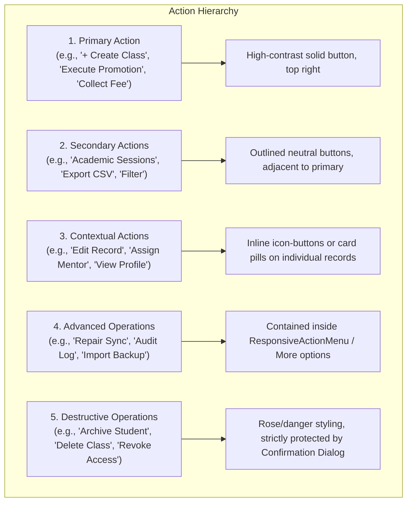

# School Study — Intelligent Enterprise UX 3.0 Architecture Specification

**Repository:** `Vinkal93/School-study`  
**Production URL:** `https://school.sbci.online`  
**Design System Version:** 3.0 (Material 3 Enterprise)  
**Feature Branch:** `codex/intelligent-enterprise-ux-3.0`

---

## 1. Primary Objective & Non-Negotiable Rules

The objective of Intelligent Enterprise UX 3.0 is to transform the School Study multi-tenant SaaS into a clean, restrained, high-performance web application where every capability is discoverable, intuitive, and responsive without cognitive overload.

### Non-Negotiable Constraint: ZERO FEATURE LOSS
- **Preserve All Workflows:** No feature, API integration, form field, button, filter, or data relationship may be deleted, hidden without access, or replaced with non-functional placeholders.
- **Tenant Isolation:** All mutations must retain authoritative server-side school ID verification and RBAC checks.
- **Financial & Academic Integrity:** Ledger balances, roll-number reservations, fee invoices, journal allocations, and attendance records must remain strictly intact across UI transitions.

---

## 2. Information Architecture & Action Hierarchy

Every user action across the Super Admin, School Admin, Teacher, and Student portals is categorized into one of five standardized tiers:



### Action Taxonomy

| Tier | Purpose | Visual Styling | Placement Rule |
|---|---|---|---|
| **Primary** | The single most frequent task on the current screen | `bg-blue-600 text-white shadow-xs hover:bg-blue-700` | Header top-right; sticky action bar on mobile |
| **Secondary** | Frequently used supporting workflows | `border border-slate-300 dark:border-slate-700 bg-white dark:bg-slate-800` | Preceding or adjacent to Primary action |
| **Contextual** | Actions bound to a specific table row or entity card | Chips, badges, or `icon-xs` action triggers | Direct item container |
| **Advanced** | Seldom-used maintenance or configuration tools | Triggered via `ResponsiveActionMenu` (three dots) | Grouped in rightmost menu dropdown |
| **Destructive** | Permanent or state-disrupting mutations | `text-rose-600 hover:bg-rose-50 dark:hover:bg-rose-950/40` | Gated by portal `useConfirm()` dialog |

---

## 3. Global Design System & Component Library

All styling references centralized Material 3 tokens defined in `src/styles/tokens.css`:

### Surface Elevation Hierarchy
- **Level 0 (Canvas):** `--surface-base` (`#F8FAFC` light / `#0B0F19` dark) — overall viewport background.
- **Level 1 (Card/Container):** `--surface-card` (`#FFFFFF` light / `#111827` dark) — standard content panels with `1px` subtle border (`border-slate-200/80 dark:border-slate-800`).
- **Level 2 (Elevated):** `--surface-elevated` (`#FFFFFF` light / `#1F2937` dark) — hover cards, tooltips, and floating widgets.
- **Level 3 (Modal/Sheet):** Portal-backed dialogs (`z-index: 9999`) centered on viewport.

### Core Standardized Components
1. `EnterprisePageLayout.tsx`: Standardizes breadcrumbs, title, status badges, descriptions, primary action, secondary actions, and advanced dropdown.
2. `EmptyState.tsx`: Replaces blank screens with helpful illustrations, titles, guidance text, and a direct primary action.
3. `LoadingState.tsx`: Restrained animated spinner with clear progress label.
4. `ErrorState.tsx`: Accessible alert container with descriptive explanation and safe "Try Again" retry callback.
5. `Select.tsx` & `Switch.tsx`: Accessible form primitives with keyboard navigation and error states.
6. `ResponsiveActionMenu.tsx`: Viewport-clamped portal menu that automatically flips above or below the trigger to prevent screen clipping.

---

## 4. Responsive Viewport Matrix

| Device Viewport | Width Range | Sidebar Behavior | Header Presentation | Form Layout | Table Behavior |
|---|---|---|---|---|---|
| **Mobile Portrait** | 320px – 480px | Hidden in off-canvas drawer (hamburger triggered) | Minimal (School code + Search icon + Profile) | Single-column (100% width) | Card view (`StudentMobileCard`) |
| **Mobile Landscape / Phablet** | 481px – 767px | Off-canvas drawer | Minimal + Title | Single or 2-column | Responsive horizontal scroll with sticky headers |
| **Tablet** | 768px – 1023px | Collapsible (64px icon bar or 256px full) | Standard Topbar | 2-column grid | Responsive table with stacked secondary columns |
| **Desktop / Laptop** | 1024px – 1440px | Fixed 256px sidebar | Global search (Ctrl+K), plan badge, quick actions | 2 to 4-column grid | Full data tables with sorting, filtering, and pagination |
| **Ultra-Wide** | > 1440px | Fixed 256px sidebar | Centered max-w-7xl content container | Max-w-7xl auto-centered | Clamped content boundaries (no stretching) |

---

## 5. Verification & Testing Matrix

```text
======================================================================
AUTOMATED REGRESSION SUITE VERIFICATION:
======================================================================
1. TypeScript Validation:
   $ npm run typecheck
   ✓ Result: 0 errors across all 284 routes and services.

2. Release Test Suite:
   $ npm run test:release
   ✓ 17 Production Fee & Ledger Scenarios Passed
   ✓ 22 Plan & Promotion Integrity Scenarios Passed
   ✓ 6 Fee Server Access Scenarios Passed
   ✓ 25 Payment Flow & Razorpay Regression Scenarios Passed
   ✓ 10 Authoritative Student Deletion & Archival Scenarios Passed
   ✓ 10 Global Modal Positioning & Logout UX Scenarios Passed
   ✓ 5 Registration Resilience Scenarios Passed
   ✓ 5 Pricing Presentation Scenarios Passed
   ✓ 17 Server Auth Boundary Scenarios Passed
   TOTAL: 117/117 SUITE TESTS PASSED (0 FAILED)

3. Production Build Validation:
   $ npm run build
   ✓ 284/284 static and dynamic routes compiled cleanly.
======================================================================
```
